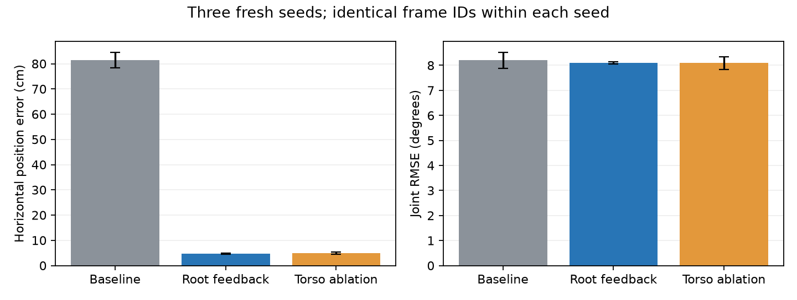

# InstantTrack + Root Position Feedback

基于 [InstantTrack](https://github.com/Huy-Quang-Dao/instantTrack) 的 G1 全身动作跟踪改进版本。在原策略观测中加入参考轨迹相对于机器人根节点的三维位置误差，以减少全局位置漂移。

上游基准提交：`a33691a08bca8802d9d2985f62e2567479735a8e`。本仓库保留上游 MIT 许可和第三方署名，来源见 [docs/UPSTREAM.md](docs/UPSTREAM.md)。

## 已验证的结果

相同 40 条 LAFAN1 动作、三个全新种子 1/2/3、每次 6,000 迭代。误差在每个种子内使用三种方案共有的相同帧计算，表中为跨种子的均值 ± 样本标准差。

| 方案 | 水平位置误差 ↓ | 关节角 RMSE ↓ | 各种子完成动作数 |
| --- | ---: | ---: | --- |
| InstantTrack 基线 | 81.47 ± 3.11 cm | 8.20 ± 0.32° | 39/40、40/40、40/40 |
| **根节点位置反馈** | **4.75 ± 0.17 cm** | **8.11 ± 0.04°** | **40/40、40/40、40/40** |
| 躯干位置反馈消融 | 4.94 ± 0.50 cm | 8.09 ± 0.25° | 40/40、39/40、39/40 |

根节点方案的水平误差降低约 94%，三个种子均通过预设验收。默认训练配置为根节点方案；`none` 和 `torso` 开关用于重现对照。

这是训练动作上的验证，位置观测来自仿真真值。尚未验证未见动作、带定位误差的输入或实机部署；这些数字也不构成跨仓库排名。原始统计、训练 loss 和计算方式见 [results/three_seed](results/three_seed) 与 [docs/EXPERIMENTS.md](docs/EXPERIMENTS.md)。



## 安装与数据

使用 Linux x86_64、Python 3.12 和 NVIDIA GPU。三种子实验使用 24 GiB RTX 3090，每次训练一张卡；已验证的软件版本见 [reproducibility/tested_environment.json](reproducibility/tested_environment.json)。依赖锁定在本仓库的 `uv.lock`，安装只创建项目内 `.venv`。

```bash
git clone https://github.com/rascal-yang/instanttrack-root-feedback.git
cd instanttrack-root-feedback
uv sync --frozen
uv run python tools/download_data.py
uv run python tools/download_data.py --verify-only
```

数据下载固定到 Hugging Face 提交 `ce1572906efe6157840e8474d5a0d7aa87481e74`，并校验 40 条 CSV 和机器人资产的 SHA-256。下载内容写入 `data/`，不进入 Git。

已有数据可通过 `INSTANTTRACK_DATA_DIR=/path/to/data` 指定，目录下应有 `lafan1_g1/` 和 `g1_description/`。动作数据来自 Ubisoft LAFAN1，经 [LAFAN1_Retargeting_Dataset](https://huggingface.co/datasets/lvhaidong/LAFAN1_Retargeting_Dataset) 提供 G1 重定向版本；数据和机器人资产沿用各自许可，见 [THIRD_PARTY_NOTICES.md](THIRD_PARTY_NOTICES.md)。

## 训练

```bash
# 推荐：相同的 6,000 迭代根节点反馈配置
uv run python scripts/train_root.py --gpu 0 --seed 1 --log-dir logs/root_s1

# 相同训练配置，关闭新增位置观测作为基线
uv run python scripts/train_root.py --gpu 0 --seed 1 --baseline --log-dir logs/baseline_s1

# 查看实际命令，不启动 GPU
uv run python scripts/train_root.py --seed 1 --dry-run
```

配置见 [configs/root_feedback.json](configs/root_feedback.json)。`--gpu` 接受物理卡编号或 GPU UUID，启动时检查 Torch 与 Warp 指向同一张卡。其余原生参数可放在 `--` 后，例如 `-- --iterations 100 --num_envs 128`；修改训练预算后，应单独标记实验。

默认保存初始检查点及 2,000/4,000/6,000 迭代检查点，训练 loss 写入 `train_log.csv`。配置保留了实验中的 2 小时训练上限；若提前触发上限，需要按实际迭代数报告结果。`--resume` 沿用上游语义，本仓库报告的三个种子均从随机初始化开始，不包含断点续训验证。

## 评测与可视化

```bash
uv run python -m instanttrack.evaluate --run_dir logs/root_s1 \
  --ckpt logs/root_s1/ckpt_006000.pt --record logs/root_s1/trajectory.npz
uv run python tools/tracking_metrics.py logs/root_s1/trajectory.npz \
  --motion-dir data/lafan1_g1 --out logs/root_s1/tracking_metrics.json
uv run python tools/render.py logs/root_s1/trajectory.npz logs/root_s1/preview.mp4 \
  --clips walk1_subject1 --seconds 30 --global_ghost

# 批量评测一个训练目录的检查点
uv run python tools/eval_batch.py --run_dir logs/root_s1
```

评测器从检查点读取观测模式，兼容旧的 99 维观测与新增的 102 维观测。`tracking_metrics.py` 使用原始 CSV 独立生成参考，计算全局水平误差、朝向误差和关节 RMSE，不做坐标配准或时间对齐。完成率与有效帧覆盖需一起报告。

## ONNX 导出

```bash
uv sync --frozen --extra export
uv run python tools/export_onnx.py --ckpt logs/root_s1/ckpt_006000.pt \
  --motion data/lafan1_g1/walk1_subject1.csv --out logs/root_s1/walk1.onnx
uv run python tools/play_onnx.py logs/root_s1/walk1.onnx \
  --motion data/lafan1_g1/walk1_subject1.csv
```

根节点版本的 ONNX 输入包含位置误差，额外输出下一帧参考根节点位置。实际控制器需要在与参考轨迹一致的坐标系中估计机器人根节点位置，才能组装该观测。ONNX 回放使用仿真状态，不代表实机部署验证。动作烘焙后的 ONNX 文件及权重默认不进入 Git。

## 检查与结果复算

```bash
uv run python -m unittest discover -s tests -v
uv run python tools/report_results.py --check
uv run python tools/report_results.py --plots
```

[docs/METHOD.md](docs/METHOD.md) 说明新增观测和初始化；[docs/EXPERIMENTS.md](docs/EXPERIMENTS.md) 说明实验预算与指标；[reproducibility](reproducibility) 保存上游提交、输入校验值、验证补丁和来源记录。
